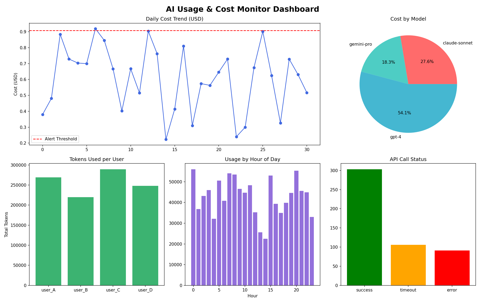

# TokenSentry - AI Cost Watchdog

A Streamlit dashboard that monitors AI API usage and cost across GPT-4, Claude Sonnet and Gemini Pro, with threshold-based alerts.

## Features
- Daily cost limit alert
- Error rate monitoring
- Long session detection
- Key metrics: total cost, sessions, average tokens, success rate
- Charts: daily cost trend, tokens by user, usage by hour, cost by model

## Tech Stack
Python, Streamlit, Pandas, Matplotlib

## Project Structure
- step1_generate_data.py: generates the usage dataset
- step2_analysis.py: cost and usage analysis
- step3_dashboard.py: static dashboard (Matplotlib)
- step4_alerts.py: alert system
- app.py: interactive Streamlit dashboard

## Note on Data
The dataset is simulated (generated with Python and Faker) to demonstrate the monitoring logic. No real API calls are tracked.

## Run Locally
pip install streamlit pandas matplotlib faker
streamlit run app.py

## Live Demo
Coming soon

## Author
Sabarinathan S - https://github.com/sabari7813
